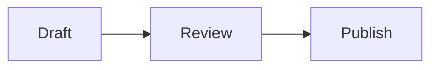

# Chart support

Use fenced `mermaid` blocks for diagrams:



Use fenced `chart` or `chartjs` blocks with a Chart.js JSON configuration:

```chart
{
  "type": "bar",
  "data": {
    "labels": ["Jan", "Feb", "Mar"],
    "datasets": [{ "label": "Readers", "data": [120, 190, 260], "backgroundColor": "#397b96" }]
  },
  "options": { "plugins": { "title": { "display": true, "text": "Monthly readers" } } }
}
```

Supported data-chart types: bar, line, pie, doughnut, radar, polarArea, scatter, and bubble. Configuration is JSON, so JavaScript callbacks and external plugins are not supported. Invalid charts keep their source visible with an error message. Mermaid uses strict security and plain-text labels.

Charts render locally and are included in PDF and PNG downloads. Theme changes redraw them. Libraries are loaded from `vendor/` only when a chart is present: Mermaid 12.0.0 and Chart.js 4.5.1 (MIT licensed).

In Typesetting, choose among six font stacks and twelve paper themes. Georgia, Palatino, and Verdana use installed fonts with fallbacks. Turn off **Filename & reading stats** and/or **Decorative marks** to simplify the document without removing its title.

PDF downloads use image-based pages, so text is not selectable. Long image exports are delivered as a ZIP of numbered PNGs. Remote document images must permit cross-origin access; embed images as data URLs when the remote host does not allow it.
